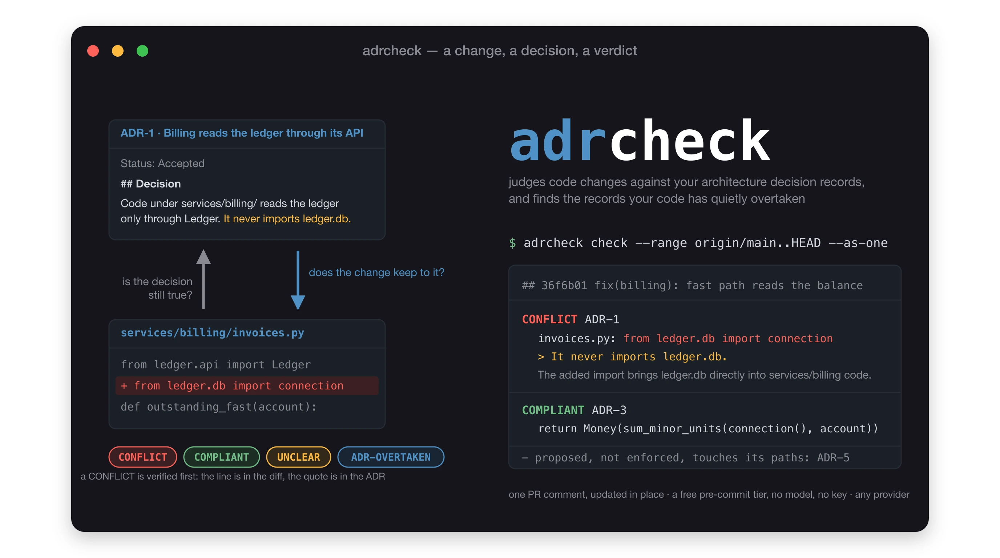

# adrcheck



Checks code changes against a team's architecture decision records (ADRs), in both directions,
and publishes its own false-alarm rate.

- A commit that breaks an accepted ADR is reported as CONFLICT, with the changed line, the
  ADR quote it contradicts, and a one-sentence reason. Every quote is verified against the
  ADR, every line against the diff, before you see it.
- An ADR the code has already moved past is reported as ADR-OVERTAKEN instead of flagging the code,
  and the stale list at the end of every run names the records whose anchors are gone.
- Anything the evidence does not settle is UNCLEAR. Abstaining is a verdict, not a miss.

Advisory by default. Structured JSON out, so a caller can gate if it wants to.

Status: pre-release. Measured on two repositories so far; the numbers and the labelled rows are in
`docs/spikes/` and `evals/cases/`. See `docs/design.md` for the module boundaries and `docs/adr/` for
the decisions adrcheck holds itself to (it checks its own pull requests against them).

## Quickstart

The full documentation is under [docs/](docs/README.md): getting started, what the verdicts mean, the flow
as diagrams, use cases by role, writing ADRs that compile, and providers.

ADRs live in the repository as numbered markdown files, in any of the common shapes (Nygard, MADR,
Y-statements, Tyree and Akerman, bold labels, a table). adrcheck binds on the role of a section, not
its heading: the decision and its consequences bind, the context explains, the considered options
never bind.

```bash
# run from a clone, no install
uvx --from git+https://github.com/kevin-burns/adrcheck adrcheck --help

# hygiene of the ADR set, no model
adrcheck lint --adr-dir docs/adr

# compile ADRs into obligations once; cached under .adrcheck/obligations, safe to commit
adrcheck compile --adr-dir docs/adr

# one decision: its obligations, where each anchor lives in the code, which are stale; no judge
adrcheck explain --adr-dir docs/adr --adr 7

# judge a branch as the one change it merges; exit 2 on a verified CONFLICT, 3 when nothing could be evaluated
adrcheck check --adr-dir docs/adr --range origin/main..HEAD --as-one --format md --fail-on conflict

# or commit by commit, for a sweep over history
adrcheck check --adr-dir docs/adr --range v1.0..v2.0 --format md
```

The model is chosen with `--model provider:model`. `anthropic:claude-sonnet-5-5` uses the Anthropic
API and needs `ANTHROPIC_API_KEY` in the environment; `claude-cli:sonnet` uses a logged-in Claude Code
install and needs no key. `openai:<model>` posts to any OpenAI-compatible endpoint, `OPENAI_BASE_URL`
and `OPENAI_API_KEY` from the environment; `ollama:<model>` is the same against `OLLAMA_HOST`, default
`http://localhost:11434`. Those two report a cost of zero because no price table fits every endpoint.
A commit that touches nothing an ADR governs costs no model call. A commit that does costs one call; input tokens run about 1,500 to 60,000 through the API depending on
the diff, and far more through the Claude CLI, which adds its own system prompt (`docs/providers.md`).
Measured runs are in `docs/spikes/`. `--compile-model` puts the compile seat on
a different provider, for example a local model for the once-per-ADR compile and Sonnet for the judge.
The obligation cache is keyed by ADR text and prompt version, not by model: delete `.adrcheck/obligations`
to recompile after changing the compile model. Provider setup, measured judge costs, and how to bound the bill
are in [docs/providers.md](docs/providers.md).

Waive an ADR for one commit with a trailer that carries a reason:

```text
Adr-Exception: ADR-3 migration script, reverted in the next commit
```

### Adopting on a repository with history

The first run lists every accepted ADR whose named anchors are no longer in the tree. Review that list
once and keep it:

```bash
adrcheck check --adr-dir docs/adr --commit HEAD --write-baseline   # writes .adrcheck/baseline.json
```

Commit the file. Later runs count the rows it names and list only new ones. Nothing rewrites it except
another `--write-baseline`; edit it like source when an ADR is retired or an anchor is renamed.

ADRs that cannot carry an `Applies to` line can be scoped from the repository instead:

```toml
# .adrcheck/map.toml
[[adr]]
id = 4
paths = ["enrich/**", "cli.py"]
```

The header wins where both exist, and `adrcheck lint` reports the disagreement.

### Before a commit

```yaml
# .pre-commit-config.yaml
- repo: https://github.com/kevin-burns/adrcheck
  rev: main
  hooks:
    - id: adrcheck-lint          # ADR hygiene when an ADR file changes; no model
    - id: adrcheck-staged        # free tier: forbidden patterns from the cached compile, stale sweep; no key
    - id: adrcheck-staged-judge  # opt-in: the model judges the index on the developer's own provider
```

The free tier is the default for `--staged`. Run `adrcheck compile` once and commit `.adrcheck/obligations/`
first, or the hook reports every ADR as not compiled and passes. It never compiles and never calls a model: an
ADR with no cached obligations is reported as not compiled, an ADR with no forbidden pattern as not judged, and only a forbidden
pattern on an added line is a CONFLICT, which goes through the same verification and parent probes as a
model's claim.

### In a pull request

```yaml
# .github/workflows/adrcheck.yml
on: pull_request
permissions:
  contents: read
  pull-requests: write
jobs:
  adrcheck:
    runs-on: ubuntu-latest
    steps:
      - uses: actions/checkout@v7.0.1
        with:
          fetch-depth: 0
      - uses: kevin-burns/adrcheck@main
        env:
          ANTHROPIC_API_KEY: ${{ secrets.ANTHROPIC_API_KEY }}
        with:
          adr-dir: docs/adr
          max-calls: "10"
```

Or, for the cheaper judge measured in `docs/providers.md`, a repository secret holding an OpenRouter key
and a repository variable for the base URL:

```yaml
      - uses: kevin-burns/adrcheck@main
        env:
          OPENAI_BASE_URL: ${{ vars.OPENAI_BASE_URL }}   # https://openrouter.ai/api/v1
          OPENAI_API_KEY: ${{ secrets.OPENAI_API_KEY }}
        with:
          adr-dir: docs/adr
          model: openai:anthropic/claude-haiku-5.5
          max-calls: "10"
```

### In a GitLab merge request

`.gitlab-ci.yml` in this repository is the template: one job on `merge_request_event` that judges the merge
request as one change and writes the findings as a Code Quality report, which the merge-request widget
shows inline with no token and no API call. Two masked CI/CD variables, `OPENAI_BASE_URL` and
`OPENAI_API_KEY`; exit 3 is allowed to fail as a warning, exit 2 fails the job.

```sh
adrcheck check --range "origin/${CI_MERGE_REQUEST_TARGET_BRANCH_NAME}..HEAD" --as-one \
  --format md --fail-on conflict --codequality gl-code-quality-report.json
```

The action posts one comment with the report and updates it on every push. A verified CONFLICT fails
the step. "Could not evaluate" (no key, provider down) is a warning, not a failure: an unreachable
model is not a finding.

### Measuring a change to the prompts or the rules

Labelled cases live under `evals/cases/`, one JSON file per corpus: commit, ADR, the verbatim binding
quote, the agreed verdict. Re-run a corpus and score it in one command:

```bash
adrcheck eval --cases evals/cases/adrcheck.json --run --report /tmp/adrcheck-eval.json
```

Exit 0 only when every case hits. A private corpus names its repository by environment variable and the
ADR revision it was labelled against; the repository itself is never bundled.

### Verdicts

| Verdict | Meaning | Exit code |
|---|---|---|
| CONFLICT | a changed line contradicts a quoted sentence of the ADR's decision; both verified | 2 with `--fail-on conflict` |
| COMPLIANT | the change touches the ADR's ground and keeps to it | 0 |
| UNCLEAR | the diff does not settle it; the reason is shown | 0 |
| ADR-OVERTAKEN | the contradiction was already there at the parent commit: an anchor already gone, the same line already elsewhere, or a removed name nothing called; the ADR, not the change, is stale | 0 |

## Prior art and credit

- Michael Nygard, "Documenting Architecture Decisions" (2011), the ADR format.
- Neal Ford, Rebecca Parsons and Patrick Kua, *Building Evolutionary Architectures*
  (O'Reilly, 2017), architectural fitness functions.
- The first trigger was practical: a project the author worked on kept its decisions as ADRs while
  coding agents wrote much of the code, and nothing checked that what the agents produced still
  matched what the records said. That project and the people on it are under NDA and are not named
  here; adrcheck carries none of its material.
- The second trigger was a LinkedIn discussion started by David Boyne on 2026-11-05 about checking
  code against the ADRs kept in EventCatalog ([the post](https://lnkd.in/p/eH_ZRsYz); written up on the
  EventCatalog blog as "Turn your ADRs into automated checks"). The comment thread named the two hard problems
  adrcheck is built around: decisions about intent cannot be read off a diff, and an ADR the code has
  quietly overtaken produces the false alarms. EventCatalog's checks serve catalogues of domains,
  services and messages; adrcheck serves any repository that keeps markdown ADRs, with no catalogue.
  Shared idea, different space. The verify step, cited line in the diff and quote in the ADR, is the
  same discipline. Nothing was taken from the EventCatalog source, which is under the Business Source
  License.
- Archgate (archgate.dev, Apache-2.0): ADRs with companion `.rules.ts` files that a CLI, a GitHub
  Action, a pre-commit hook and editor plugins enforce, plus published governance studies. Rules
  there are code the team writes; adrcheck compiles the obligations out of the prose instead, and
  judges with a model whose claims are verified. Read for ideas on 2026-11-09, no code copied.
- adr-kit (rvdbreemen/adr-kit, MIT): an MCP server and hooks for Claude Code, Codex and Copilot that
  hand the coding agent the governing decision before it edits, check commits against declarative
  rules, and watch for stale decisions. The before-the-edit surface adrcheck has not built yet. Read
  for ideas on 2026-11-09, no code copied.
- ruflo-adr (ruvnet/ruflo, MIT): ADR id references in code as a scoping signal, and the ADR
  graph hygiene checks.
- zircote/adr (MIT): front-matter-first selection with stated exclusions, and the
  "what not to flag" list.
- MADR, Markdown Any Decision Records (adr.github.io/madr, MIT or CC0): the "Confirmation" section is the natural home for compiled obligations.
- The architecture-decision-record template collection by Joel Parker Henderson (the collection's own text is CC BY-NC-SA 4.0; each template keeps its original author's licence): the catalogue adrcheck's role map is built from. adrcheck maps template section names to roles and copies no template text.
- Two unrelated projects are called ADR Guard. (1) chohan-sarmad-ali/delivery-gates (MIT): a GitHub Action that fails a PR when watched paths change without an ADR being added or updated, with an `ADR-Exempt:` trailer, plus a duplicate-number gate. (2) rodri-oliveira-dev/adr-guard (MIT, .NET): an ADR toolkit that validates structure, status, links and supersession (codes ADR001-ADR014), correlates git changes with an explicit ADR-to-code map (`impact`), verifies narrow fitness rules against effective ADRs with "unknown is never pass" semantics and reviewable baselines (`drift`), and reviews an ADR's text with a model (`review`). Neither reads the code to judge whether a change complies with a decision; that is adrcheck's job, and it composes with both. adrcheck borrows from (2) the explicit outcome vocabulary pass / violation / unknown / not-applicable, the distinct exit code for "could not evaluate", and baselines reviewed like source.

## Licence

Apache-2.0.
