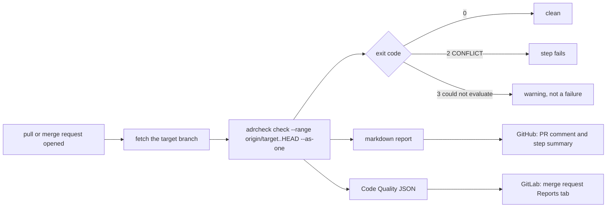

# adrcheck in CI: GitHub and GitLab

The same check on the two platforms. One run per pull request or merge request, the change judged as the one
change it merges (ADR-13), a report where reviewers already look, and a failed step only on a verified
CONFLICT. What differs is the surface each platform offers for the report, and one thing GitLab needs that
GitHub does not.



| | GitHub | GitLab |
|---|---|---|
| unit of work | the pull request, `--as-one` | the merge request, `--as-one` |
| trigger | `on: pull_request` | `rules: merge_request_event`, plus the default branch |
| report surface | one comment, updated in place, plus the step summary | Reports tab, from a Code Quality artifact |
| the surface needs | a token with `pull-requests: write`, from the runner | nothing: GitLab reads the artifact |
| baseline | none | a pipeline on the target branch, see below |
| CONFLICT | step fails (`fail-on-conflict`, default on) | job fails (`--fail-on conflict`, exit 2) |
| could not evaluate | warning, the step passes | warning, `allow_failure: exit_codes: [3]` |
| secrets | repository secret, and a variable for a base URL | masked CI/CD variables |
| cap on spend | `max-calls` input | `--max-calls` on the command |

## GitHub

The Action lives in this repository and is used by it. The workflow below is what runs on every pull request
here, with the judge measured cheapest in [providers.md](providers.md):

```yaml
# .github/workflows/adrcheck.yml
name: adrcheck
on:
  pull_request:
permissions:
  contents: read
  pull-requests: write
jobs:
  adrcheck:
    runs-on: ubuntu-latest
    steps:
      - uses: actions/checkout@v7.0.1
        with:
          fetch-depth: 0
      - uses: kevin-burns/adrcheck@main      # or @v0.1.0 to pin a release
        env:
          OPENAI_BASE_URL: ${{ vars.OPENAI_BASE_URL }}   # https://openrouter.ai/api/v1
          OPENAI_API_KEY: ${{ secrets.OPENAI_API_KEY }}
        with:
          adr-dir: docs/adr
          model: openai:anthropic/claude-haiku-5.5
          max-calls: "10"
```

With an Anthropic key instead, drop the `env` block for one line, `ANTHROPIC_API_KEY: ${{ secrets.ANTHROPIC_API_KEY }}`,
and omit `model`; the default is Sonnet through the Anthropic API.

What the Action does, step by step:

1. Installs adrcheck from the Action's own checkout, so the version that runs is the one pinned by `uses:`.
2. Fetches the base branch if the checkout did not bring it, as `origin/<base>`. With `fetch-depth: 0` it is
   already there.
3. Runs `adrcheck check --range origin/<base>..HEAD --as-one`, writes the markdown report, and appends it to
   the job's step summary.
4. Posts the report as one comment on the pull request and updates that comment on every push, so a
   pull request carries one adrcheck comment, never a trail. On a pull request from a fork the comment step
   is skipped, because the runner's token cannot write there; the step summary still has the report.
5. Fails the step on exit 2 when `fail-on-conflict` is on. Exit 3 never fails the step: an unreachable model
   is not a finding (ADR-3).

Inputs: `adr-dir`, `model`, `base`, `comment`, `fail-on-conflict`, `max-calls`, `github-token`. Outputs:
`exit-code` and `report`, the path of the markdown file, for a later step that wants it.

## GitLab

`.gitlab-ci.yml` at the root of this repository is the template:

```yaml
stages:
  - check

adrcheck:
  stage: check
  image: ghcr.io/astral-sh/uv:python3.13-bookworm   # not -slim: the fetch below needs git
  rules:
    - if: $CI_PIPELINE_SOURCE == "merge_request_event"
    - if: $CI_COMMIT_BRANCH == $CI_DEFAULT_BRANCH
  variables:
    GIT_DEPTH: "0"
    MODEL: openai:anthropic/claude-haiku-5.5
  before_script:
    - uv tool install git+https://github.com/kevin-burns/adrcheck
    - export PATH="$HOME/.local/bin:$PATH"
    - |
      if [ -n "${CI_MERGE_REQUEST_TARGET_BRANCH_NAME}" ]; then
        TARGET="${CI_MERGE_REQUEST_TARGET_BRANCH_NAME}"
        git fetch --no-tags origin "+refs/heads/${TARGET}:refs/remotes/origin/${TARGET}"
        RANGE="origin/${TARGET}..HEAD"
      else
        RANGE="HEAD~1..HEAD"
      fi
  script:
    - adrcheck check --adr-dir docs/adr --range "${RANGE}" --as-one --model "${MODEL}"
      --format md --fail-on conflict --codequality gl-code-quality-report.json
  allow_failure:
    exit_codes: [3]
  artifacts:
    when: always
    reports:
      codequality: gl-code-quality-report.json
    paths:
      - gl-code-quality-report.json
    expire_in: 30 days
```

Set `OPENAI_BASE_URL` and `OPENAI_API_KEY` as masked CI/CD variables under Settings, CI/CD, Variables. (In
this repository the install line is `uv tool install .`, since the code is already checked out.)

What the job does:

1. On a merge request, fetches the target branch and judges `origin/<target>..HEAD` as one change. The
   markdown goes to the job log; the same findings go to `gl-code-quality-report.json` in Code Climate form:
   `check_name` is `adrcheck/ADR-N`, CONFLICT is `major`, UNCLEAR `minor`, ADR-OVERTAKEN `info`, COMPLIANT
   is not listed, and the fingerprint is a hash of ADR, obligation, file and line, so a finding keeps its
   identity across pushes.
2. Declares that file as a `codequality` report. GitLab reads it into the merge request's Reports tab with
   no token and no API call from the job.
3. Fails the job on exit 2. Exit 3 is allowed to fail, which GitLab shows as a warning.

**The baseline.** GitLab does not list a merge request's findings as they are; it lists the difference
between the merge request's report and the report of the latest pipeline on the target branch at the
merge-base. With no such pipeline the tab says "Code Quality hasn't changed", whatever the artifact holds.
That is why the job also runs on every push to the default branch, judging only the commit that landed:
a clean main writes an empty list, and every finding on a merge request is then new. We found this the
hard way: the first test merge request had a correct artifact with one major finding and a tab that said
nothing had changed. Inline marks in the Changes tab are a GitLab Ultimate feature; on Free and Premium the
Reports tab is the surface.

## What it did on our side

Both surfaces are in use on this repository, not only documented.

- **GitHub.** The self-check workflow above has judged every pull request here since it was added, while the
  repository was still private. It has raised two verified CONFLICTs, both real: a mechanical judge placed in the domain package
  where it imported the ports module (ADR-1), and a probe renamed in code while ADR-7 still named the old
  function. The first was fixed in code, the second by amending the record; the second shape, code right and
  decision log behind, is the common one.
- **GitLab.** A copy of the repository at gitlab.com/KevinBurns/adrcheck runs the job above. A test merge
  request planting `import subprocess` in a domain module came back CONFLICT ADR-1, the job failed with
  exit 2, and the Code Quality artifact carried the finding as `major adrcheck/ADR-1`. The same run showed
  the baseline requirement described above.

Both platforms use the same command, the same ADRs and the same judge. Nothing in adrcheck knows which one it
is on: the Action and the job are each a few lines around `adrcheck check`, and a third platform would need
the same few lines and a place to put the report.
