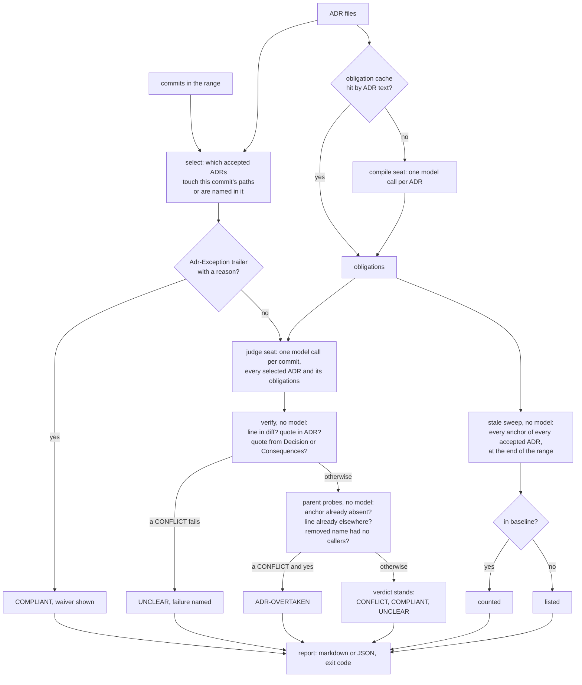
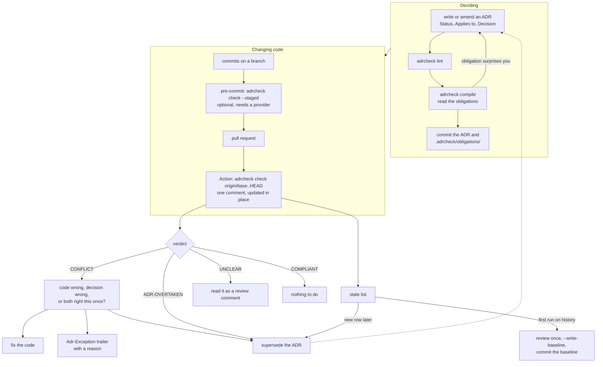

# The flow

Two diagrams. The first is what happens inside one `adrcheck check` run. The second is what a team does
around it: where the ADR is written, where the report lands, and what each verdict asks someone to do.

## Inside one run



Two places call a model, the compile seat and the judge seat; everything else is deterministic. The
compile seat runs once per ADR and its output is cached by the ADR's text and the prompt version, so a
repository that commits `.adrcheck/obligations/` pays for compile again only when an ADR changes or
adrcheck's compile prompt does. The judge seat runs once per commit that touches governed paths, or that
selects an ADR with no `Applies to`. A commit that touches nothing an ADR governs never reaches it.

The order after the judge matters. Verification runs before any verdict is shown, so a CONFLICT you read
has a real line and a real quote behind it. The parent probes run after, and only on CONFLICTs, so they can
turn blame into "the ADR is stale" but never turn a compliant change into anything else.

## Around the run



Three places a decision can be enforced, and they are the same check with a different range:

| Where | Range | Who pays | When to use |
|---|---|---|---|
| developer's machine | `--staged`, the index | nothing: the free tier runs no model | before commit; forbidden patterns from the cached compile and the stale sweep, no key. `--tier judge` adds the model on the developer's own provider |
| pull request | `origin/<base>..HEAD` | the repository's CI key | the default; one comment per PR, updated on every push |
| a sweep over history | `--range v1.0..v2.0` | whoever runs it | adopting on a repository with history; finding when a decision was left behind |

The two hooks, for a repository that uses pre-commit or prek:

```yaml
- repo: https://github.com/kevin-burns/adrcheck
  rev: main
  hooks:
    - id: adrcheck-lint          # no model; runs when a file under the ADR directory changes
    - id: adrcheck-staged        # free tier: no model, no key; forbidden patterns and the stale sweep
    - id: adrcheck-staged-judge  # opt-in: the model judges the index on the developer's own provider
```

## What a CONFLICT asks of you

The report never decides for you. A verified CONFLICT means the code and the written decision disagree, and
one of them is wrong.

- The code is wrong: fix it. The next push updates the comment.
- The decision is wrong: write the superseding ADR, mark the old one Superseded, compile, commit. The
  CONFLICT disappears because the old ADR is no longer Accepted.
- Both are right this once: add the trailer to the commit message.

```text
Adr-Exception: ADR-4 one-off backfill of the November export; the importer returns in the next commit
```

The waiver is per commit and shows in the report as COMPLIANT with the reason, so nothing is silent.

## What the stale list asks of you

Different question, different answer. A stale row is not about the commits in the range; it says an
obligation mandates names that no longer exist anywhere in the code (defined on the
[verdicts page](verdicts.md#the-stale-list)). On a repository adopting adrcheck, expect many rows on the
first run. Review them once. For each, either supersede the ADR, fix the ADR's anchors, or accept the row
and record it:

```sh
adrcheck check --range origin/main..HEAD --write-baseline
git add .adrcheck/baseline.json
```

From then on those rows are counted, not listed, and only new rows demand attention. Edit the baseline like
source: a row you remove reappears in the next report.
